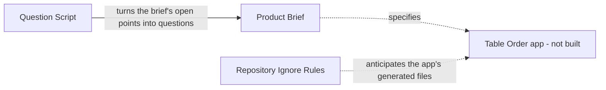
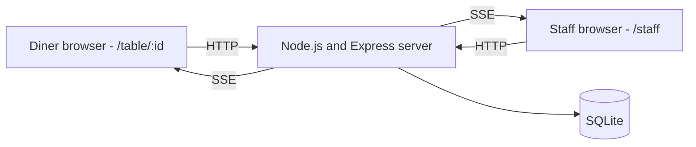
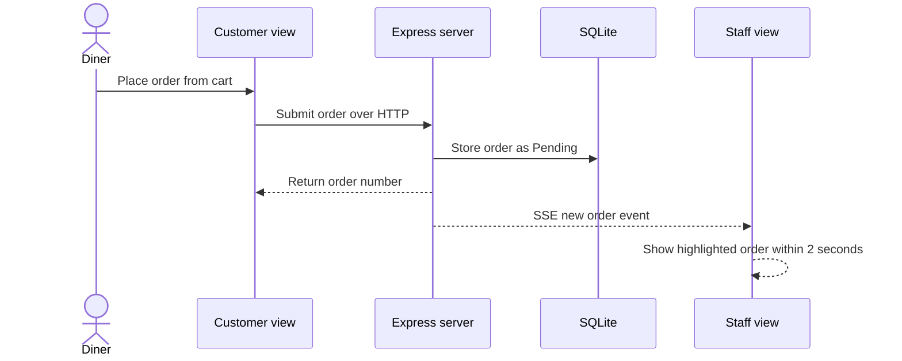
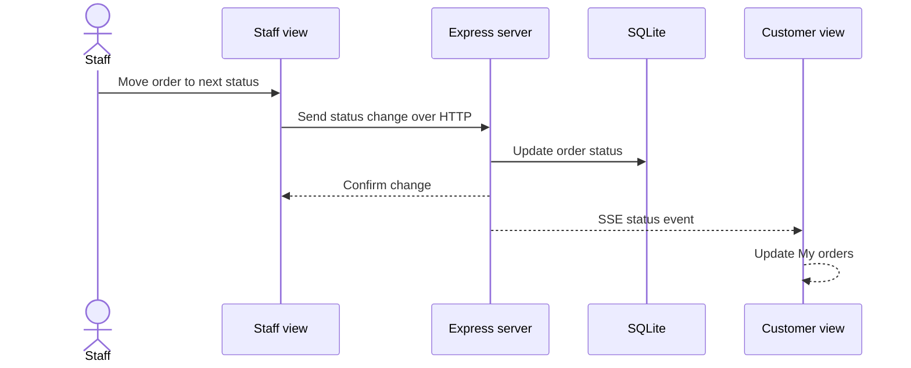
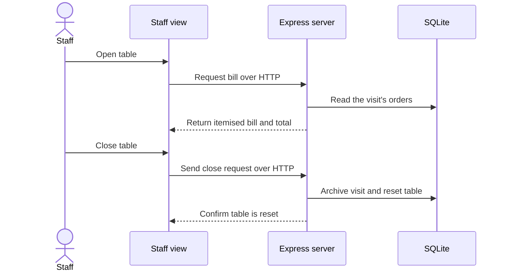

# Architecture

## Architecture Analysis

### System Overview

There is no running system. The repo contains documents only, so this file separates what exists from what the brief intends. Every diagram of the application shows intent from `ideas/table-order/IDEA.md`, not code.

### Architectural Style

- **Today**: none. No source code exists.
- **Intended by the brief**: a single locally run web application: a React single-page app served with a Node.js/Express server, SQLite for storage, and Server-Sent Events for live updates (`IDEA.md` lines 38-41). The brief does not name a style, but one app started by one command implies a monolith.

### Component Relationships

What exists in the repo today:

<!-- Text fallback: The Question Script refers to the Product Brief. The Product Brief specifies the Table Order app, which is not built. The Repository Ignore Rules anticipate the app's generated files. -->

What the brief intends (not implemented):

<!-- Text fallback: Diner and staff browsers call the Express server over HTTP. The server pushes live updates to both over Server-Sent Events and stores data in SQLite. None of this is implemented. -->

The brief states the technologies but not this wiring in detail; the diagram is the plainest reading of them. The component split is decided later, at Domain Design. `QUESTIONS.md` lines 283-285 list three options and recommend an eight-component split, which is not yet a decision.

### Data Flow

No data flows today, and no schema exists. The brief implies these entities: table, visit, menu category, menu item, order, order line. Their fields, and whether a cart is stored on the device or the server, are undecided. The script's recommended assumption is that each device keeps its own cart (`QUESTIONS.md` line 184).

### Key Design Decisions

Decisions already stated in the brief:

| Decision | Implication |
|---|---|
| React, Express, SQLite and SSE | Later stages design within this stack |
| Local only, started by one command | No cloud infrastructure is needed for the product itself |
| One app with two views | Shared server and data, with one codebase |
| New orders on the board within 2 seconds | A timing requirement the live-update design must meet and tests must check |
| Built screens must match high-fidelity mockups | Mockups come before the screens |

### Security Considerations

No security controls exist because no code exists. Staff access is an open question (`IDEA.md` line 29). The script's recommended option leaves the staff view unprotected and relies on the app running only on the local machine (`QUESTIONS.md` line 160). If the team accepts it, that assumption stops holding as soon as the server is reachable from other devices, so the design stage should state which network address the server listens on.

### Improvement Opportunities

- Settle the five open questions first, because they change the data model and the bill and close flow.
- Add a README once the app exists, because the repo has no entry-point documentation.

## Interaction Diagrams

No business transaction is implemented. These diagrams show the journeys the brief describes, using its named technologies, so that later stages can compare their designs against them. Route paths and internal calls are deliberately left out because no contract exists yet.

### Place an Order (Intended)

<!-- Text fallback: The diner places an order. The customer view sends it to the server, which stores it as Pending and returns the order number. The server pushes an event to the staff view, which shows the highlighted order within 2 seconds. Intended only. -->

### Change Order Status (Intended)

<!-- Text fallback: Staff move an order from Pending to Preparing or Preparing to Completed. The server stores the change, confirms it, and pushes an event so the customer view updates My orders. Intended only. -->

### Bill and Close a Table (Intended)

<!-- Text fallback: Staff open a table and the server returns the itemised bill and total. Staff close the table and the server archives the visit and resets the table for the next diner. Intended only. Whether closing is allowed with unfinished orders is an open question. -->

Whether a table can close with unfinished orders is undecided, and the brief does not say what an open diner device sees after a close. The script raises that second point as a review finding (`QUESTIONS.md` line 198).
