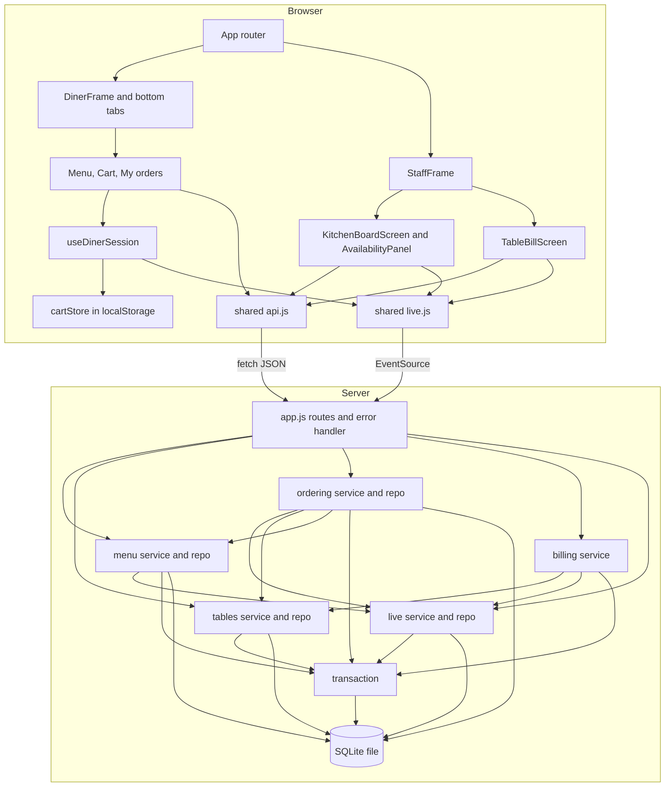
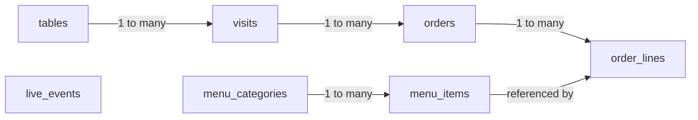
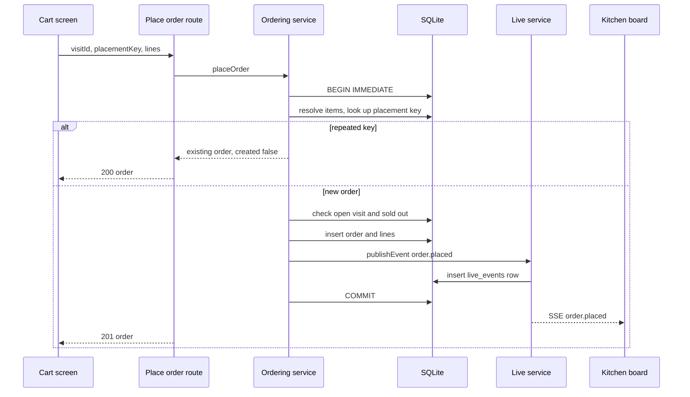
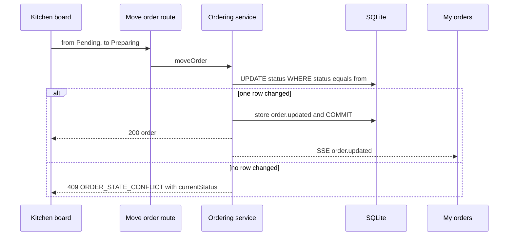
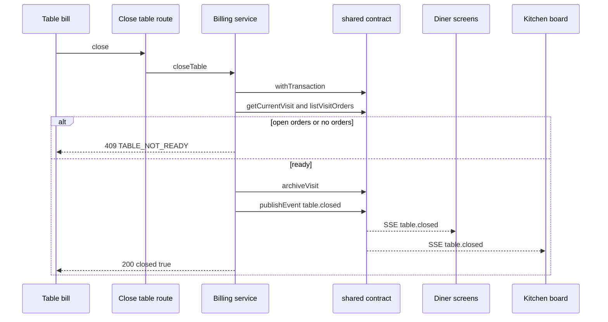
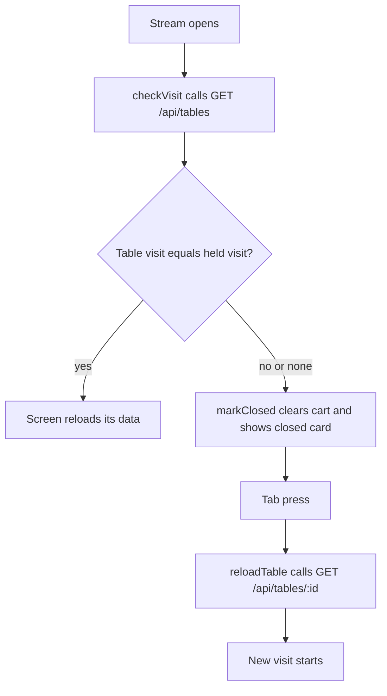

# Architecture

## Architecture Analysis

### System Overview

Table Order v1 is one Node.js process. It serves a JSON API, a Server-Sent Events (SSE) stream and a built React single-page app, and stores everything in one SQLite file. Commit analysed: `324e1c6`.

### Architectural Style

Modular monolith.

- One deployable, one process, one database (`server/index.js`, `server/context.js`).
- The server is organised by domain, each with a `service` and usually a `repo`, built by factory functions that receive their dependencies (`server/context.js`). There is no dependency-injection library.
- Layering within a domain: route (`server/app.js`) → service (rules, transactions) → repo (SQL, row mapping).
- The client is a single-page app with two frames, one for diners and one for staff.

### Component Relationships

Text fallback: the browser has a diner frame and a staff frame. All of their screens reach the server through `api.js` (fetch) and `live.js` (EventSource). On the server, `app.js` calls one service per domain. Menu, ordering and billing publish through the live service. Ordering reads items and tables. Billing uses only the `shared` contract and `requireTable`. All writes go through the transaction helper to SQLite.

### Data Model

Text fallback: categories hold items; tables hold visits; visits hold orders; orders hold lines, which reference an item. `live_events` stands alone and has a nullable `table_id` and no foreign key.

All in `server/platform/db.js:6-62`:

| Table | Columns | Constraints |
|---|---|---|
| `menu_categories` | `id` TEXT PK, `name`, `position` | `position` UNIQUE |
| `menu_items` | `id` TEXT PK, `category_id` FK, `name`, `description`, `price_cents`, `image`, `sold_out` default 0, `position` | `price_cents >= 1`; `sold_out IN (0,1)` |
| `tables` | `id` INTEGER PK, `label` | `id BETWEEN 1 AND 10` |
| `visits` | `id` TEXT PK, `table_id` FK, `status` default `Open`, `started_at`, `closed_at` | status `Open`/`Closed`; unique partial index `one_open_visit_per_table` |
| `orders` | `id` TEXT PK, `number` UNIQUE, `visit_id` FK, `status` default `Pending`, `placement_key` UNIQUE, `placed_at` | status in 4 values; index on `visit_id` |
| `order_lines` | `id` TEXT PK, `order_id` FK, `item_id` FK, `name`, `unit_price_cents`, `quantity`, `position` | quantity 1 to 20; index on `order_id` |
| `live_events` | `sequence` INTEGER PK AUTOINCREMENT, `type`, `table_id`, `payload` JSON text, `created_at` | none |

`PRAGMA foreign_keys = ON` is set on open. Timestamps are ISO-8601 text.

### Data Flow

- **Writes**: route → service → `withTransaction` (`BEGIN IMMEDIATE`, synchronous only) → repo. An event is inserted into `live_events` inside the same transaction and sent only after commit, so a rolled-back change is never announced (`server/live/service.js:42-49`).
- **Live delivery**: `broadcast` sends a frame to each subscribed client whose `tableId` is null, or matches the event, or when the event has no table.
- **Catch-up**: `EventSource` reconnects by itself with `Last-Event-ID`; the server replays from the stored events, or sends `resync` if they are gone or older than one hour. Events are pruned hourly.
- **Client reconciliation**: each screen reloads on every connection open. Live events merge by order id, and a replay cannot move an order backward (`STATUS_RANK`).

### Key Design Decisions

| Decision | Evidence | Implication for v2 |
|---|---|---|
| Synchronous single-connection SQLite | `server/platform/transaction.js:1-5` | Check-then-write is safe with no extra locking. Transaction work must stay synchronous. |
| Events stored in the transaction | `server/live/service.js:42-49` | New event types need no server-side registration. |
| Order price snapshot on the line | `server/ordering/service.js:72-78` | An option-adjusted price can be stored in `unit_price_cents`, and bill, totals and screens keep working. |
| Bill is calculated, not stored | `server/billing/service.js` | No billing storage to change. |
| Cart stays on the device | `cartStore.js` | Per-device diner settings (allergies) have a precedent. |
| Billing depends only on `shared` (C4) | `server/context.js:38-44` | Close-time behaviour for new features (clearing waiter calls) needs either `shared` extended or a hook at close. |
| Staff and diner screens share the API without separation | `server/app.js` | Staff PIN needs a route-by-route decision. |

### Improvement Opportunities

- Introduce a versioned, additive migration step before anything else in the database changes.
- Gather order status knowledge (icons, rank, chip) into one shared module.
- Give diners a read that returns only their own table's visit, so the board route can be restricted to staff.

## v2 Change Seams

These are facts about where each feature attaches. They are not design decisions.

### Database and seed

- `SCHEMA` uses `CREATE TABLE IF NOT EXISTS` only. New tables can be added there and will reach an existing database. New columns cannot: `openDatabase` needs a separate step, guarded for example by `PRAGMA table_info` or `PRAGMA user_version`, run before use.
- `ALTER TABLE ... ADD COLUMN` with NOT NULL needs a default. That matches the project's rule that database changes only add.
- A SQL `CHECK` cannot be altered in place. A new order status such as "Ready" would mean rebuilding `orders`, which is not additive. Today's four statuses are also hard-wired into `NEXT_STATUS`, `NEXT_MOVE`, `STATUS_RANK` (2 files), `STATUS_ICONS` (3 files) and `styles.css`.
- `seedIfEmpty` returns early once `tables` has rows. New reference data (allergens, options) needs its own idempotent backfill for the existing `data/table-order.db`.
- `seed-data.js` items are positional arrays read by destructuring in `insertSeedRows`. Added values should go somewhere that leaves those arrays and their count alone.
- The seed must stay at 10 tables, 4 categories and 12 items. Tests assert those counts in `tests/server/platform.test.js:25`, `e2e/u2-diner-screens/menu.spec.ts:24`, `e2e/u3-kitchen-board/availability.spec.ts:11`, and elsewhere.

### Order and item shapes

- Client sends `{ visitId, placementKey, lines: [{ itemId, quantity }] }`. The server takes price and name only from the menu. An option choice must be sent as ids and priced on the server.
- `validatePlacement` is the boundary to extend (`server/ordering/service.js:18-35`).
- Order lines returned are `{ name, quantity, unitPriceCents }`. `item_id` is stored but not returned. Line display lives in 3 places: board, My orders, bill.
- Exact-shape tests are listed in `code-quality-assessment.md`.

### Cart

- Lines are identified by `itemId` in `add`, `changeQuantity`, `remove`, `removeItems`, the React `key`, and the test ids `cart-line-`, `cart-more-`, `cart-fewer-`, `cart-quantity-`, `cart-remove-`, `cart-limit-`.
- An `ITEM_SOLD_OUT` refusal names item ids. With options, removal by item id still removes every variant.
- `isValidLine` must keep accepting v1-shaped saved carts.
- `MenuItemCard`'s `+ Add` adds at once. V1 tests rely on one press adding an item for coffee, garlic bread, pizza, cheeseburger, ice cream, apple pie and lemonade, among others.

### Live event stream

- Server: `publishEvent({ type, tableId, ...payload })` accepts any type.
- Client: `EVENT_TYPES` in `client/src/shared/live.js:3` is an allowlist. An unlisted type never reaches a screen.
- Streams belong to screens. `DinerFrame` has none; `useDinerSession` opens one per screen, and it reopens on every tab change. A new connection has no `Last-Event-ID`, so an event landing during a tab change is not replayed; screens cover this by reloading. A diner notification based only on events could miss one at that moment.
- Only `MyOrdersScreen` acts on order events. `MenuScreen` and `CartScreen` get them through `onEvent` and ignore them.

### App shell and routes

- Adding a screen address takes two edits: `SCREEN_ROUTES` (`server/app.js:6-12`) and `client/src/App.jsx`. `tests/server/api.test.js:276` runs over `SCREEN_ROUTES` automatically.
- The tab bar has exactly 3 columns (`.tabs` in `styles.css`), and the u1 mockup-match spec compares labels and `columns` with v1's mockups.
- `.summary` is fixed at `bottom: 72px`. `.diner` reserves `padding-bottom: 164px`. A new fixed bar must fit into that stack.
- `prefers-reduced-motion` already stops every animation and transition globally (`styles.css:131-134`), which covers an animated tracker or a pulse if they use CSS animation.

### Staff pages and the PIN

- `StaffFrame` wraps both staff screens, so a single client-side gate fits there.
- Client-side gating alone protects nothing, since the API has no checks. Staff-only operations are in `api-documentation.md`.
- `EventSource` cannot set request headers, so `GET /api/events` can only be protected by a cookie or a URL parameter.
- `GET /api/tables` is called by diners on every connection (`useDinerSession.js:61`), and by e2e waits (`liveReady`).
- Any PIN value must come from the environment, per the Construction security rule.

## Interaction Diagrams

### Placing an order

Text fallback: inside one transaction the server resolves the items and looks up the placement key. A repeat returns the first order with 200. Otherwise it checks the visit and sold-out marks, inserts the order and lines, stores the event and commits. The event then goes to the board and the response returns 201.

### Moving an order, with a competing cancel

Text fallback: the update applies only if the order is still in the status the screen saw. On success the order is returned and announced. Otherwise the staff screen gets a 409 with the current status.

### Closing a table

Text fallback: billing reads the current visit in a transaction, refuses if any order is open or none exist, otherwise archives the visit and announces `table.closed`. Diner screens clear themselves; the board reloads.

### Diner reconnect and missed close

Text fallback: on each stream open the diner checks the board read, which starts no visit. If the visit still matches, the screen reloads; if not, the device resets to the closed card. Only a tab press or refresh calls the read that starts the next visit.
