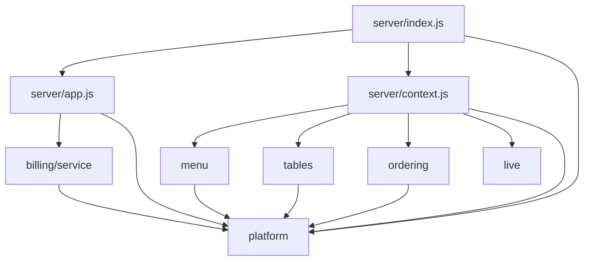

# Dependencies

## External Dependencies

Declared in `package.json`; exact versions are in `technology-stack.md`.

| Group | Packages |
|---|---|
| Runtime | `express`, `react`, `react-dom`, `react-router-dom`, `vite`, `@vitejs/plugin-react` |
| Development | `@playwright/test`, `@types/node`, `@vitest/coverage-v8`, `supertest`, `typescript`, `vitest` |

No external service is called. The app needs no network beyond the local machine. No outdated-package or security advisory check was run in this scan.

## Internal Server Dependencies

Text fallback: `index.js` loads `app.js`, `context.js` and platform. `context.js` builds menu, tables, ordering and live. `app.js` builds billing directly, from `context.shared`. Domains import only `platform/errors.js` statically. They reach each other only through objects passed in by `context.js`.

Runtime links passed in by `context.js`:

| Component | Receives |
|---|---|
| Menu service | menu repo, transactions, `publishEvent` |
| Tables service | tables repo, ordering repo, transactions, `now` |
| Ordering service | ordering repo, menu repo, tables repo, tables service, transactions, `publishEvent`, `now` |
| Billing service | `shared`, `requireTable` |
| Live service | live repo, transactions, log, `now` |

No circular imports were found. The Tables service reading the ordering repo and the Ordering service using the Tables service is a two-way runtime link, resolved because the Tables service takes only the repo.

## Internal Client Dependencies

| File | Depends on |
|---|---|
| `App.jsx` | Every screen and both frames |
| `DinerFrame` | `api`, `cartCount` |
| `useDinerSession` | `api`, `live`, `cartStore`, `sessionLogic`, outlet context from `DinerFrame` |
| Diner screens | `useDinerSession`, `parts`, `api`, `money`, `cartStore`, `sessionLogic` |
| `cartStore` | `api` (`newPlacementKey`), `cartCount` |
| `KitchenBoardScreen` | `api`, `live`, `boardLogic`, `AvailabilityPanel`, `StaffFrame` |
| `AvailabilityPanel` | `api` |
| `TableBillScreen` | `api`, `live`, `money`, `StaffFrame` |

Bolts U2, U3 and U4 of v1 share only the shell and `shared/`, by construction. Screen folders do not import each other.

## Test Dependencies on Implementation

| Test code | Depends on |
|---|---|
| `e2e/*/helpers.ts` `archiveOpenVisit` | The `visits` table and its column names, through direct `node:sqlite` access to `E2E_DB_FILE` |
| Every `mockup-match.spec.ts` | v1's mockups in `aidlc/spaces/default/intents/261105-table-order-app/inception/refined-mockups/html`, which must stay where they are |
| `tests/server/platform.test.js` | `menu_items` and `tables` columns via raw SQL |
| `tests/client/*` | Direct imports from `client/src/screens/**` |

## Build and Run Order

Build the client, then start the server; the server refuses to run without `dist/index.html`. Playwright's web server does both. `reuseExistingServer: false`, so a server already on `E2E_PORT` blocks the run.
