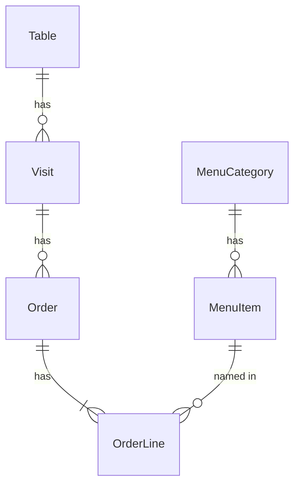

# Functional Spec: u1-walking-skeleton

Implements the server side of these stories from `stories.md`, as assigned in `unit-of-work-story-map.md`: US1.1, US1.2, US1.5, US1.6, US2.1, US2.2, US3.1, US3.2, US3.3, US5.1 and US5.2. Follows `unit-of-work.md`, `components.md`, `contract-summary.md` and `requirements.md`.

## Workflows

**W1. Start.** Read settings. Open the database. Create the schema. Seed if empty (BR6.1). Serve the API and screens.

**W2. Open a table.** A screen asks for the table. It is found (or 404). A visit starts if there is none (BR4.1). The visit id returns.

**W3. Place an order.**
1. Validate (BR2.1, BR2.2).
2. If the placement key exists, return that order (BR2.5).
3. In one transaction: check the visit (BR2.3), check sold-out items (BR2.4), number the order (BR2.6) and write the order and lines (BR2.7).
4. After commit, publish `order.placed`.

**W4. Move or cancel.** Check the rule (BR3.1, BR3.2). Apply only if still in the expected status (BR3.3). After commit, publish `order.updated` (BR3.4).

**W5. Mark sold out.** Store the mark. After commit, publish `menu.item-updated` (BR1.4).

**W6. Live stream.** A screen subscribes, with its table if it has one (BR5.2). On reconnect it receives what it missed, or `resync` (BR5.1).

**W7. End-to-end slice.** A plain diner page at `/table/:id` lists the menu and places an order. A plain staff page at `/staff` shows it arrive. U2 and U3 replace these pages.

## Order State Machine

| From | Event | Guard | To | Action |
|---|---|---|---|---|
| (new) | place | BR2.1 to BR2.4 | Pending | publish order.placed |
| Pending | move | still Pending | Preparing | publish order.updated |
| Preparing | move | still Preparing | Completed | publish order.updated |
| Pending | cancel | still Pending, own table's visit | Cancelled | publish order.updated |

Completed and Cancelled are final.

## Visit State Machine

| From | Event | To |
|---|---|---|
| (none) | table opened by a diner screen | Open |
| Open | archive (called by U4) | Closed |

## Entity Relationships

Derived from `entities.md`.

<!-- Text fallback: a category has items; a table has visits; a visit has orders; an order has lines; a line names one item. -->

## Rules Summary

Derived from `rules.md`: BR1 menu, BR2 placing, BR3 status and cancelling, BR4 tables and visits, BR5 live events, BR6 start-up and data.

## Assumptions & Open Questions

None beyond those in `rules.md`.
