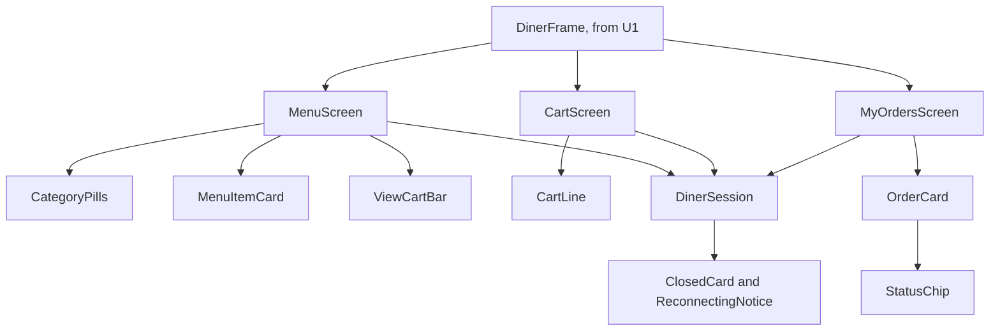

# Frontend Components: u2-diner-screens

All live in the diner screens' area and sit inside U1's diner frame, which supplies `table` and `reloadTable`.

## Hierarchy

Text fallback: the frame holds the three screens. The Menu has pills, item cards and the View cart bar. The Cart has its lines. My orders has order cards with status chips. Each screen uses the diner session, which supplies the closed card and the reconnecting notice.

## Components

| Component | State and inputs | Behaviour |
|---|---|---|
| Cart store | Per table: visit id, lines (item id, name, price, image, quantity), placement key | Reads and writes local storage, updates the badge, takes a new key when lines change |
| DinerSession | `table`, `reloadTable`, screen callbacks; gives `connected` and `closed` | Holds the live stream, spots a close, clears the cart, checks the visit on each reconnect, ignores events and reloads while closed, and starts the next visit when a tab is pressed |
| MenuScreen | menu, load status | BR1.1 to BR1.4 |
| CategoryPills | categories, current category | Sticky; scrolls smoothly unless reduced motion is asked for |
| MenuItemCard | item, quantity in cart | "+ Add" looks 32 px tall with a 44 px touch area, or "Sold out" |
| ViewCartBar | item count, total | Sits above the tab bar; hidden when the cart is empty |
| CartScreen | sending flag, message | BR2 and BR3 |
| CartLine | line | Stepper with labels "One fewer X" and "One more X", the limit hint, Remove |
| MyOrdersScreen | orders, load status, message | BR4 and BR5; shows "Order #N placed" from the navigation |
| StatusChip | status | Word, hidden icon and colour; polite announcement |

## API Integration

| Screen | Calls |
|---|---|
| Every screen, on reconnect | `GET /api/tables`, to check the visit without starting one |
| Menu | `GET /api/menu`; stream events `menu.item-updated`, `resync`, `table.closed` |
| Cart | `POST /api/tables/:id/orders`; stream event `table.closed` |
| My orders | `GET /api/tables/:id/orders`, `POST .../cancel`; stream events `order.placed`, `order.updated`, `resync`, `table.closed` |

## Form Validation

There are no free-text inputs. The only values a diner sets are quantities, limited by BR2.2.
