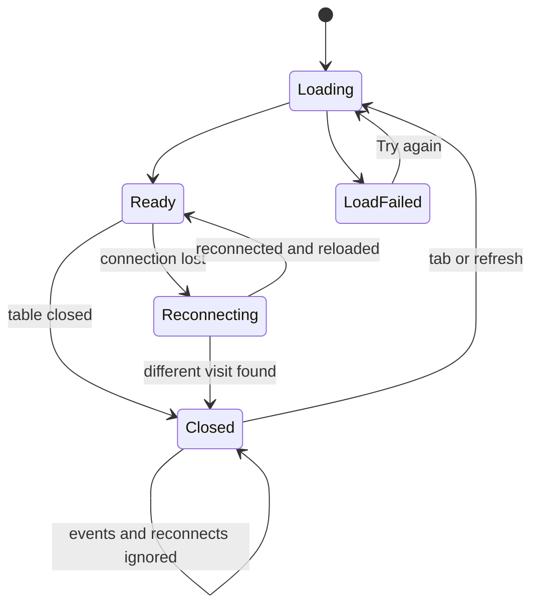

# Functional Spec: u2-diner-screens

Implements from `stories.md`: US1.1, US1.2, US1.3, US1.4, US1.5, US1.6, US2.1, US2.2, US4.3, US5.2 and US5.3. Built from the U2 entry in `unit-of-work.md`, the FRs and NFRs in `requirements.md`, the DinerApp entry in `components.md` and the refined mockups. U2 uses contracts C1, C2 and C5 and has no server code. No questions were asked for this Unit: the upstream documents settle it.

## Workflows

### W1: Choose from the Menu

1. The frame finds the table and its visit. An unknown table shows "Table not found" (U1).
2. The saved cart is read. A cart from another visit is cleared (BR2.4).
3. The Menu shows skeletons, then its categories, or the error with Try again (BR1.2).
4. A pill scrolls to its category, and the pill of the category on screen is filled in.
5. "+ Add" adds one and updates the Cart badge and "View cart" (BR2.1, BR2.2).

### W2: Place an order

1. The diner presses Place order, which is disabled while sending. The saved placement key goes with the request (BR3.2).
2. Success: the cart empties and My orders opens with "Order #N placed" (BR3.1).
3. `ITEM_SOLD_OUT`: the items are named and removed (BR3.3), and the diner can place the rest.
4. `TABLE_CLOSED`: the reset in W5 runs.
5. Anything else: the cart stays and the message shows (BR3.4).

### W3: Follow orders

1. My orders reads the visit's orders (BR4.1).
2. Live events replace or add orders (BR4.2).
3. A lost connection shows the reconnecting notice. Each new connection reloads, so nothing is missed (BR4.3).

### W4: Cancel

1. A Pending order offers Cancel order (BR5.1).
2. Success: the order shows Cancelled.
3. `ORDER_STATE_CONFLICT`: the current status and the message show (BR5.2).
4. Any other failure: an error shows and the order stays as it was.

### W5: The table closes

1. One of three signals arrives: `table.closed` for the held visit; a new connection finding a different visit; or `TABLE_CLOSED` on placing.
2. The cart, the orders and the badge are cleared, and the closed card replaces the screen (BR6.1).
3. A `table.closed` for a visit this device no longer holds is ignored, so a replayed event cannot wipe a new cart.
4. While closed, the device ignores live events and reloads nothing. A new connection checks the visit through `GET /api/tables`, which starts no visit (BR6.2).
5. Pressing a tab or refreshing starts the next visit, and only then does the device adopt it.

## Screen States

Text fallback: a screen goes from Loading to Ready or LoadFailed, and Try again returns to Loading. Ready and Reconnecting swap as the connection changes. Either can become Closed, and a tab press or a refresh returns to Loading on a new visit.

## Rules Summary

Derived from `rules.md`, the source of truth: BR1 Menu, BR2 cart, BR3 placing, BR4 My orders, BR5 cancelling, BR6 reset, BR7 keyboard and motion.

## Seams With Other Units

- U2 replaces only `client/src/screens/diner/`, and calls `setCartCount` from U1.
- Tests publish the close through U1's `POST /api/test/events`, so U4's code is not needed.
- For U4: after a device starts a new visit by a refresh or a tab press, the table has a current visit with no orders, so a repeat close returns 409 as C3 states. The bill's button is already disabled in that state.

## Assumptions & Open Questions

- My orders lists the newest order first, as in the mockup.
- With several sold-out items, the names are joined with "and" and the sentence says "them".
- The closed card keeps the tab bar, which is how the next diner starts.
- A cart line keeps its name and price from when it was added. Prices do not change while the app runs, so the Cart needs no loading state.
- Reopening a tab after a close clears the cart with no message (BR2.4), as AC4.3.3 asks only for an empty view.
