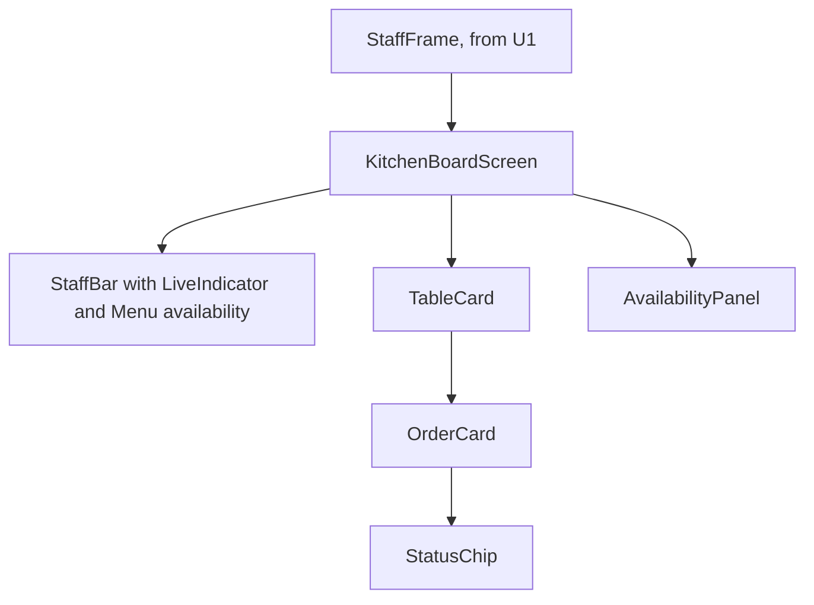

# Frontend Components: u3-kitchen-board

These sit inside U1's staff frame.

## Hierarchy

Text fallback: the frame holds the board. The board has the bar, ten table cards with order cards and status chips, and the availability panel.

## Components

| Component | State and inputs | Behaviour |
|---|---|---|
| Board logic | tables, a live order | Plain functions: merging an order without moving it back, the move offered, the highlight, refusal wording |
| KitchenBoardScreen | tables, load status, message, panel open | BR1, BR2, BR3 |
| TableCard | table | Heading, "Open bill", "No orders" or its orders |
| OrderCard | order, moving flag | "★ New", items, status, the one move offered |
| StatusChip | status | Word, hidden icon and colour; polite announcement |
| AvailabilityPanel | categories, saving ids, message | BR4; focus and Escape as BR5.1 |

## API Integration

| Part | Calls |
|---|---|
| Board | `GET /api/tables`; `PUT /api/orders/:id/status`; stream events `order.placed`, `order.updated`, `table.closed`, `resync` |
| Panel | `GET /api/menu`; `PUT /api/menu/items/:id/sold-out`; stream event `menu.item-updated` |

## Form Validation

There are no free-text inputs. The switches and buttons can only send values the server accepts.
