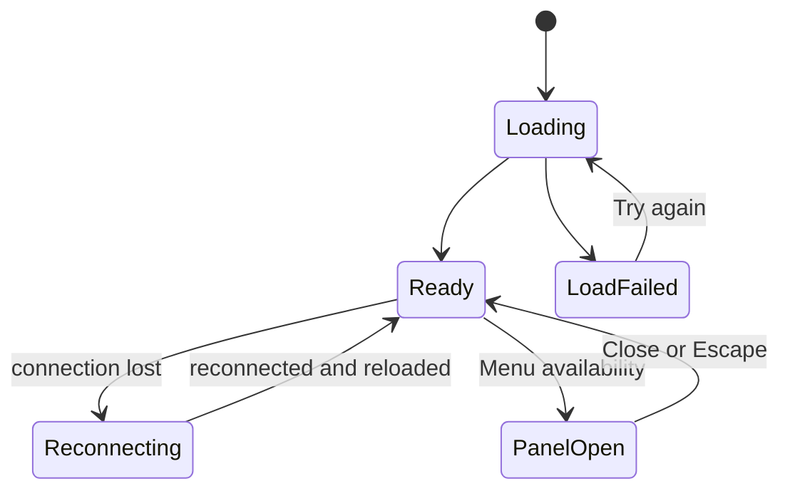

# Functional Spec: u3-kitchen-board

Implements from `stories.md`: US3.1, US3.2, US3.3 and US5.3. Built from the U3 entry in `unit-of-work.md`, the FRs and NFRs in `requirements.md`, the StaffApp entry in `components.md`, the refined mockups and the answer in `functional-design-questions.md`. U3 uses contracts C1, C2 and C5 and has no server code.

## Workflows

### W1: Watch the board

1. `/staff` opens with no login and reads the board (BR1.1).
2. Live events add and update orders within 2 seconds (BR2.1).
3. Every Pending order shows "★ New" (BR2.2).
4. A lost connection shows the notice, and each new connection reloads (BR2.3).
5. `table.closed` empties that table (BR2.4).

### W2: Move an order

1. Staff press "Start preparing" or "Mark completed" (BR3.1).
2. Success: the order shows its new status. "★ New" clears on leaving Pending.
3. `ORDER_STATE_CONFLICT`: the current status and the message show, and the first change wins on every screen (BR3.2).
4. Any other failure: the order stays, and the message shows (BR3.3).

### W3: Mark an item sold out

1. "Menu availability" opens the panel, and focus moves into it (BR4.1, BR5.1).
2. A switch saves the mark, and open menus update through U1's event (BR4.2).
3. Close or Escape dismisses the panel, and focus returns to its button.

## Screen States

Text fallback: the board goes from Loading to Ready or LoadFailed, and Try again returns to Loading. Ready and Reconnecting swap as the connection changes. The panel opens over Ready and closes back to it.

## Rules Summary

Derived from `rules.md`, the source of truth: BR1 opening, BR2 live updates, BR3 moves, BR4 availability, BR5 keyboard and motion.

## Seams With Other Units

- U3 replaces `client/src/screens/kitchen/` and passes its button as a `StaffBar` child.
- "Open bill" links to `/staff/tables/:id`, which U4 fills in.
- Tests publish a close through U1's `POST /api/test/events`.

## Assumptions & Open Questions

- "Open bill" shows on every table, as in the mockup.
- Wording not in the mockups: "We couldn't load the board.", "We couldn't update Order #N. Please try again.", "We couldn't save that change. Please try again."
- A move refused because an order is already Preparing or Completed uses the general sentence in BR3.2.
- The panel's load failure offers Try again inside the panel.
