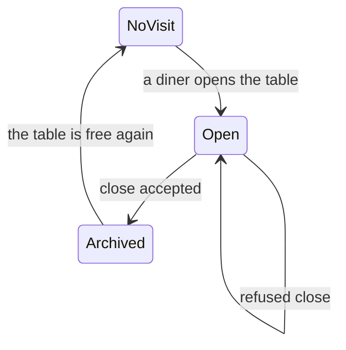
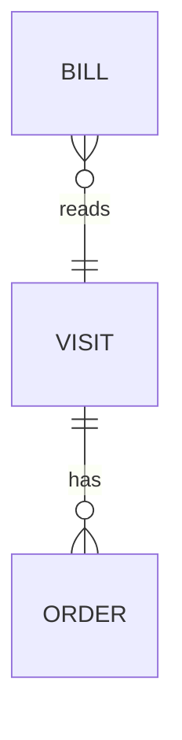

# Functional Spec: u4-bill-and-close

Implements from `stories.md`: US4.1, US4.2, US4.3 (the event) and US5.3. Built from the U4 entry in `unit-of-work.md`, the FRs in `requirements.md`, the Billing and StaffApp entries in `components.md`, and contracts C2, C3, C4 and C5. No questions were asked for this Unit: the upstream answers settle it.

## Workflows

### W1: Read the bill

1. The screen calls `GET /api/tables/:id/bill`.
2. Billing finds the current visit without starting one (BR1.4).
3. It lists non-cancelled orders, names the open ones and adds up the total (BR1.1 to BR1.3).
4. The screen stays current from live events (BR3.2).

### W2: Close the table

1. Staff press "Close table". There is no confirmation, because only a finished table can be closed.
2. In one transaction: read the current visit and its orders, check the rule, archive, and queue `table.closed` (BR2.1, BR2.2).
3. After commit the event goes out, and diner screens and the board react within 2 seconds.
4. The bill screen says the table closed, and staff return with "Back to board" (BR3.3).

### W3: Outcomes of a close

| State | Answer |
|---|---|
| Current visit, all orders finished | 200, archived, event sent |
| Current visit, an open order or no orders | 409 `TABLE_NOT_READY`, nothing changes |
| No current visit | 200, nothing changes, no event |
| Unknown table | 404 `TABLE_NOT_FOUND` |

## Visit State

Text fallback: a table has no visit until a diner opens it. A close of an open visit either is refused and leaves it open, or archives it. An archived visit never changes again, and the table returns to having no visit.

## Data View

Text fallback: a visit has orders, and a bill reads one visit. `entities.md` is the source of truth.

## Rules Summary

Derived from `rules.md`, the source of truth: BR1 the bill, BR2 the close, BR3 the screen.

## Seams With Other Units

- U4 adds a `server/billing/` component, registered in the marked route slot of `server/app.js`, and uses only `context.shared`.
- U4 replaces `client/src/screens/bill/TableBillScreen.jsx`.
- U3's board reloads on `table.closed`, and U2's screens reset on it, by contract C2. U4's code imports neither.

## Assumptions & Open Questions

- The total includes orders still open, as in the mockup's $44.00.
- Orders on the bill run oldest first, as in the mockup.
- A refused close, which needs a stale screen, shows the server's safe message.
