# Scope Document: Table Order

Built from the intent statement (`ideation/intent-capture/intent-statement.md`), the brief (`ideas/table-order/IDEA.md`) and the answers in `scope-definition-questions.md`.

## Purpose

Let diners order from their table and follow their order, and give staff one live view of every table, with a simple bill and close at the end of a visit.

## In Scope

All three features are Must Have (Q1). Together they make the full journey from ordering to the next diner sitting down, and each success measure in the intent statement needs one of them.

| Feature | What it covers | Success measures it serves |
|---|---|---|
| F1. Order from the table | Browse the menu by category (name, price, description, image). Cart: add, remove, change quantity, live total, survives a page refresh. Place an order and see its number. "My orders": this visit's orders with live status. | SM2, SM3, SM5, SM6 |
| F2. Live kitchen board | A grid of table cards. A new order appears within 2 seconds, highlighted. Staff change status from Pending to Preparing to Completed, and the diner's view updates. | SM1, SM2, SM5, SM6 |
| F3. Bill and close table | Open a table to see its itemised bill and total. "Close table" archives the visit and resets the table for the next diner. | SM4, SM5, SM6 |

Nothing inside the three features is only nice to have (Q2). Menu item images, the highlight on a new order and the cart surviving a refresh are all Must Have.

## Out of Scope

Taken from the boundary confirmed in the intent statement:

- Payments
- QR code generation
- Multi-language
- Menu management
- Past-visit history
- Notifications
- Cloud deployment

The app runs locally only.

## Deadline

There is one deadline for everything: the whole app is built, tested and signed off within the workshop session of about 5 hours (Q3). No capability has a deadline of its own.

## Value Stream Map

One table visit, from the diner sitting down to the table being reset.

```mermaid
flowchart LR
  A["Diner sits down and opens the table's page"] --> B["Browses the menu and fills the cart"]
  B --> C["Places the order and gets its number"]
  C --> D["Order appears on the kitchen board"]
  D --> E["Staff move it to Preparing, then Completed"]
  E --> F["Diner follows the status under My orders"]
  F --> G["Staff open the table's bill"]
  G --> H["Staff close the table"]
  H --> I["Visit archived, table ready for the next diner"]
```

<!-- Text fallback: the diner sits down and opens the table's page, browses the menu and fills the cart, places the order and gets its number; the order appears on the kitchen board; staff move it to Preparing and then Completed while the diner follows the status under My orders; staff open the table's bill and close the table; the visit is archived and the table is ready for the next diner. -->

| Step | Who | Feature | Value delivered |
|---|---|---|---|
| Opens the table's page, browses the menu, fills the cart | Diner | F1 | Orders at their own pace with no wait for staff |
| Places the order and gets its number | Diner | F1 | Knows the order went through |
| Order appears on the board | Staff | F2 | Sees every new order within 2 seconds |
| Moves the status forward | Staff | F2 | Keeps one live view of every table |
| Follows the status | Diner | F1, F2 | No guessing how the order is progressing |
| Opens the bill and closes the table | Staff | F3 | Finishes the visit and readies the table |

## Assumptions & Open Questions

- The value stream map follows one table visit, from the diner sitting down to the table being reset.
- If the session runs short, the team decides what to cut at the next approval point. Nothing is marked droppable in advance.
- The brief's five open questions stay open until Requirements Analysis.
