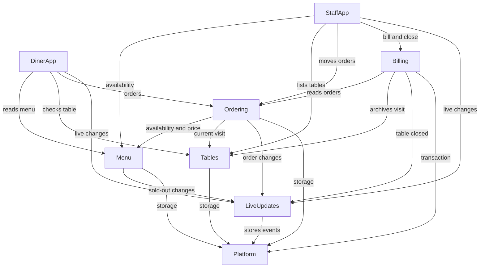

# Components: Table Order

The logical building blocks that realise `requirements.md` and `stories.md`. Types and validation detail are left to Functional Design.

```yaml
components:
  - name: Platform
    summary: Shared server foundations
    behaviour: >
      Opens the database from the DB_FILE setting, runs the schema and first-run seed once, reads PORT, gives every
      server error one shape, and logs failures. Holds no business rules.
    responsibilities:
      - Database connection, schema and seed run
      - Settings from environment variables
      - Error shape and logging
      - Transactions, with events published only after commit
    depends_on: []
    dependents:
      - component: Menu
        interaction: storage and errors
      - component: Tables
        interaction: storage and errors
      - component: Ordering
        interaction: storage and errors
      - component: Billing
        interaction: storage and errors
      - component: LiveUpdates
        interaction: storage and errors
    external_dependencies:
      - name: SQLite
        kind: database
        purpose: All durable data
    entities: []
  - name: LiveUpdates
    summary: Publishes changes to open screens and lets them catch up
    behaviour: >
      Numbers every event in order; an event's tableId is empty when it concerns no one table, as with menu changes. Sends it over Server-Sent Events to subscribers, keeps one hour of events, and
      replays the ones a reconnecting screen missed. It knows nothing about what events mean.
    responsibilities:
      - Event stream and subscriptions
      - Catch-up after a dropped connection
    depends_on:
      - component: Platform
        interaction: stores recent events
        style: sync
    dependents:
      - component: Menu
        interaction: publishes sold-out changes
      - component: Ordering
        interaction: publishes order changes
      - component: Billing
        interaction: publishes table closed
      - component: DinerApp
        interaction: subscribes to its table's changes
      - component: StaffApp
        interaction: subscribes to all changes
    entities:
      - name: LiveEvent
        identifier: sequence
        attributes: [sequence, type, tableId, payload, createdAt]
  - name: Menu
    summary: Categories, items and sold-out marks
    behaviour: >
      Serves the menu in category order. Staff mark an item sold out and back; each change publishes an event. Prices are
      whole cents. Other components ask Menu whether an item is available and what it costs.
    responsibilities:
      - Menu reads
      - Sold-out marks
    depends_on:
      - component: LiveUpdates
        interaction: publishes sold-out changes
        style: event
      - component: Platform
        interaction: storage
        style: sync
    dependents:
      - component: Ordering
        interaction: checks availability and price
      - component: DinerApp
        interaction: shows the menu
      - component: StaffApp
        interaction: shows and changes availability
    entities:
      - name: MenuCategory
        identifier: id
        attributes: [id, name, position]
      - name: MenuItem
        identifier: id
        attributes: [id, name, description, priceCents, image, soldOut, position]
        references:
          - entity: MenuCategory
            owned_by: Menu
            relationship: each item belongs to one category
  - name: Tables
    summary: The 10 tables and their current visit
    behaviour: >
      Knows which tables exist and each table's current visit, starting one when a table with none is opened, and returns
      that visit's id with the table. Ending a visit archives
      it and leaves the table with no current visit. Archived visits are stored but served to no screen.
    responsibilities:
      - Table lookup
      - Visit start and archive
    depends_on:
      - component: Platform
        interaction: storage
        style: sync
    dependents:
      - component: Ordering
        interaction: finds the current visit
      - component: Billing
        interaction: archives the visit
      - component: DinerApp
        interaction: checks that the table exists
      - component: StaffApp
        interaction: lists the tables
    entities:
      - name: Table
        identifier: id
        attributes: [id, label]
      - name: Visit
        identifier: id
        attributes: [id, status, startedAt, closedAt]
        references:
          - entity: Table
            owned_by: Tables
            relationship: each visit belongs to one table
  - name: Ordering
    summary: Placing orders and moving them through their statuses
    behaviour: >
      Validates and places orders, refusing unknown items, unknown tables, quantities outside 1 to 20 and sold-out items.
      A retry with the same placement key returns the first order. Numbers are unique across the restaurant. Statuses move
      Pending to Preparing to Completed one step at a time, and a Pending order can be Cancelled. The first change to arrive
      wins and the later one is refused. Each placement carries the visit id the device holds and runs in one transaction;
      if that visit is no longer current, as after a close, it is refused and no order is created. A diner can cancel only
      an order of their own table's current visit. Each change publishes an event after it commits.
    responsibilities:
      - Order placement and numbering
      - Status rules and cancelling
      - Order reads by visit and for the board
    depends_on:
      - component: Menu
        interaction: checks availability and price
        style: sync
      - component: Tables
        interaction: finds the current visit
        style: sync
      - component: LiveUpdates
        interaction: publishes order changes
        style: event
      - component: Platform
        interaction: storage
        style: sync
    dependents:
      - component: Billing
        interaction: reads a visit's orders
      - component: DinerApp
        interaction: places, cancels and shows orders
      - component: StaffApp
        interaction: shows and moves orders
    entities:
      - name: Order
        identifier: id
        attributes: [id, number, status, placementKey, placedAt]
        references:
          - entity: Visit
            owned_by: Tables
            relationship: each order belongs to one visit
      - name: OrderLine
        identifier: id
        attributes: [id, name, unitPriceCents, quantity]
        references:
          - entity: Order
            owned_by: Ordering
            relationship: each line belongs to one order
          - entity: MenuItem
            owned_by: Menu
            relationship: each line records one item, with its name and price at order time
  - name: Billing
    summary: The table bill and closing a table
    behaviour: >
      Works out the bill from a visit's orders: each non-cancelled order with its subtotal, one total, and which orders are
      still open. Closes a table only when it has orders and all are Completed or Cancelled; a repeat close changes nothing.
      The check and the archive run in one transaction, so an order cannot land mid-close, and table closed is published
      after it commits. It stores nothing of its own.
    responsibilities:
      - Bill calculation
      - Close-table rule
    depends_on:
      - component: Ordering
        interaction: reads a visit's orders
        style: sync
      - component: Tables
        interaction: archives the visit
        style: sync
      - component: LiveUpdates
        interaction: publishes table closed
        style: event
      - component: Platform
        interaction: runs the close as one transaction
        style: sync
    dependents:
      - component: StaffApp
        interaction: shows the bill and closes the table
    entities: []
  - name: DinerApp
    summary: Menu, Cart and My orders screens with the bottom tab bar
    behaviour: >
      Keeps each device's cart on that device, tied to the visit it began in, so it survives a refresh and clears when the
      table closes. On opening and on every reconnect it reads the table's current visit; if the cart's visit differs, it
      clears the cart and, for a screen that was open, shows "This table was closed". Receives its table's events and all
      menu events. Applies live updates, reconnects by itself and shows every state in the mockups.
    responsibilities:
      - Diner screens and navigation
      - Cart on the device
    depends_on:
      - component: Menu
        interaction: reads the menu
        style: sync
      - component: Tables
        interaction: checks that the table exists and reads its current visit
        style: sync
      - component: Ordering
        interaction: places, cancels and reads orders
        style: sync
      - component: LiveUpdates
        interaction: receives its table's changes
        style: event
    dependents: []
    external_dependencies:
      - name: Browser storage
        kind: other
        purpose: Holds the cart on the device
    entities:
      - name: Cart
        identifier: tableId
        attributes: [tableId, visitId, lines]
        references:
          - entity: MenuItem
            owned_by: Menu
            relationship: each cart line points to one item
  - name: StaffApp
    summary: Kitchen Board, Menu availability panel and Table Bill screens
    behaviour: >
      Shows all 10 tables live, highlights Pending orders, moves statuses, changes sold-out marks, shows the bill and closes
      a table. It opens with no sign-in, by decision, because the app runs only on the local machine.
    responsibilities:
      - Staff screens
    depends_on:
      - component: Menu
        interaction: reads and changes availability
        style: sync
      - component: Tables
        interaction: lists the tables
        style: sync
      - component: Ordering
        interaction: reads and moves orders
        style: sync
      - component: Billing
        interaction: reads the bill and closes the table
        style: sync
      - component: LiveUpdates
        interaction: receives all changes
        style: event
    dependents: []
    entities: []
```

## Component Diagram



<!-- Text fallback: DinerApp uses Menu, Tables, Ordering and LiveUpdates. StaffApp uses Menu, Tables, Ordering, Billing and LiveUpdates. Billing uses Ordering, Tables, LiveUpdates and Platform. Ordering uses Menu, Tables, LiveUpdates and Platform. Menu uses LiveUpdates and Platform. Tables and LiveUpdates use Platform. There are no cycles. -->

## Component Summary

| Component | Purpose | Depends On | Dependents | Entities Owned |
|---|---|---|---|---|
| Platform | Shared server foundations | None | Menu, Tables, Ordering, Billing, LiveUpdates | None |
| LiveUpdates | Live changes and catch-up | Platform | Menu, Ordering, Billing, DinerApp, StaffApp | LiveEvent |
| Menu | Items and sold-out marks | LiveUpdates, Platform | Ordering, DinerApp, StaffApp | MenuCategory, MenuItem |
| Tables | Tables and visits | Platform | Ordering, Billing, DinerApp, StaffApp | Table, Visit |
| Ordering | Orders and statuses | Menu, Tables, LiveUpdates, Platform | Billing, DinerApp, StaffApp | Order, OrderLine |
| Billing | Bill and close | Ordering, Tables, LiveUpdates, Platform | StaffApp | None |
| DinerApp | Diner screens | Menu, Tables, Ordering, LiveUpdates | None | Cart |
| StaffApp | Staff screens | Menu, Tables, Ordering, Billing, LiveUpdates | None | None |

## Entity Ownership

| Entity | Owning Component | Identifier | Attributes | References |
|---|---|---|---|---|
| LiveEvent | LiveUpdates | sequence | sequence, type, tableId, payload, createdAt | None |
| MenuCategory | Menu | id | id, name, position | None |
| MenuItem | Menu | id | id, name, description, priceCents, image, soldOut, position | MenuCategory |
| Table | Tables | id | id, label | None |
| Visit | Tables | id | id, status, startedAt, closedAt | Table |
| Order | Ordering | id | id, number, status, placementKey, placedAt | Visit |
| OrderLine | Ordering | id | id, name, unitPriceCents, quantity | Order, MenuItem |
| Cart | DinerApp | tableId | tableId, visitId, lines | MenuItem |

## External Dependencies

| Component | Dependency | Kind | Purpose |
|---|---|---|---|
| Platform | SQLite | database | All durable data |
| DinerApp | Browser storage | other | Holds the cart on the device |

## Rationale

| Component | Why it is separate |
|---|---|
| Platform | Technical foundations that change for different reasons from any business rule |
| LiveUpdates | Delivery and catch-up, with no knowledge of what events mean |
| Menu | Distinct data; changes rarely and only by a sold-out mark |
| Tables | The visit lifecycle is separate from what is ordered in it |
| Ordering | Holds the status rules and the races between diners and staff |
| Billing | Bill and close rules read orders but change none, and can be built apart from ordering |
| DinerApp | A different user, device size and cart |
| StaffApp | A different user and task from the diner screens |

### Component-boundary options

| Option | Summary | Pros | Cons | Reversibility |
|---|---|---|---|---|
| A (Recommended) | Eight components, as above | Each rule lives in one place, no dependency cycles, and after the walking skeleton the diner screens, kitchen board and bill can be built in parallel | More calls between components | Easy: components can merge later |
| B | Merge Tables and Billing into Ordering | Fewer calls | One large component, and the bill and close can't be built in parallel with ordering | Moderate |
| C | One "Restaurant" server component plus Platform and the two screen components | The simplest wiring | Every rule in one place, and no parallel build except the screens | Harder to split later |

Build notes: Billing reaches DinerApp only through LiveUpdates, so DinerApp does not depend on it. StaffApp's screens split across Units, with the board in the kitchen-board Unit and the bill in the bill Unit. Billing can be built apart from ordering because the walking skeleton carries the Ordering component.

**Recommendation:** Option A, because the team's build plan needs the bill and close to be built separately from ordering. The team chose Option A at this stage's approval. Options B and C are the alternatives rejected.

## Assumptions & Open Questions

- `image` holds the emoji.
- Live updates keep one hour of events for catching up.
- Types and validation detail are left to Functional Design.
