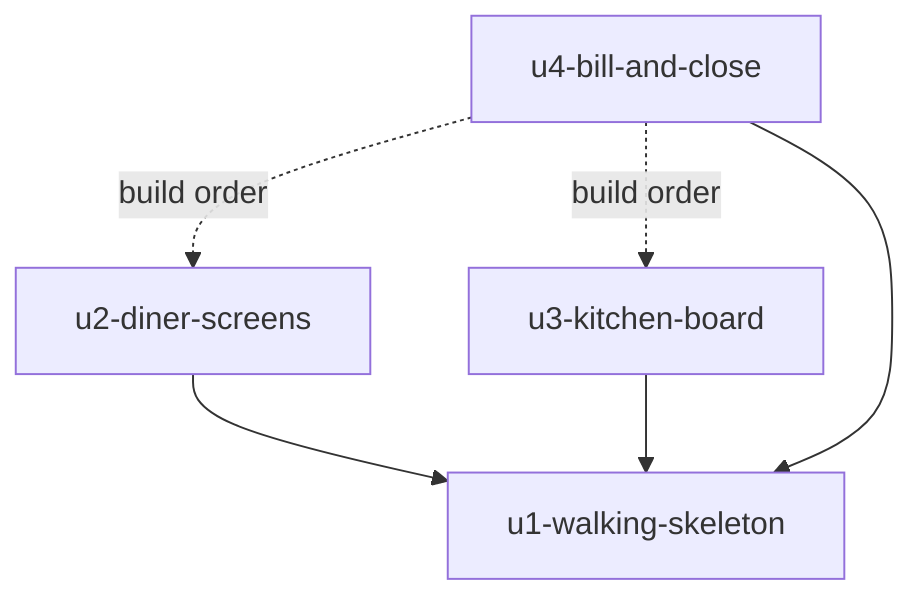

# Unit Dependencies: Table Order

## Dependency DAG

```yaml
units:
  - name: u1-walking-skeleton
    kind: service
    depends_on: []
  - name: u2-diner-screens
    kind: ui
    depends_on: [u1-walking-skeleton]
  - name: u3-kitchen-board
    kind: ui
    depends_on: [u1-walking-skeleton]
  - name: u4-bill-and-close
    kind: service
    depends_on: [u1-walking-skeleton, u2-diner-screens, u3-kitchen-board]
```



<!-- Text fallback: U2 and U3 depend on U1. U4 depends on U1 for code, and on U2 and U3 for build order only. -->

U4's edges to U2 and U3 are build-order edges chosen by the team. U4's code uses only U1.

## Walking Skeleton

`u1-walking-skeleton` is the first Unit and the integrated slice. It runs alone: its plain pages exercise the whole path from placing an order to seeing it arrive live, before any later Unit exists.

## Integration Points

| Between | Through | What crosses |
|---|---|---|
| U2 and U1 | HTTP and the live stream | Menu, table and visit reads; placing and cancelling; order, menu and table-closed events |
| U3 and U1 | HTTP and the live stream | Tables, orders and availability reads; status moves; sold-out marks; order and menu events |
| U4 and U1 | Code in the same server, HTTP and the live stream | Orders of a visit, visit archive, publishing table closed |
| U4 and U2 | The table-closed event, defined in Contract Design | No code is shared |
| U4 and U3 | The bill screen's address | No code is shared |

## Parallel Development

U2 and U3 have no edge between them, so they can be built at the same time, each in its own copy of the project. Each one's code and tests pass with only U1 and its own work.

## Assumptions & Open Questions

None. Build order and Bolts are decided at Delivery Planning.
