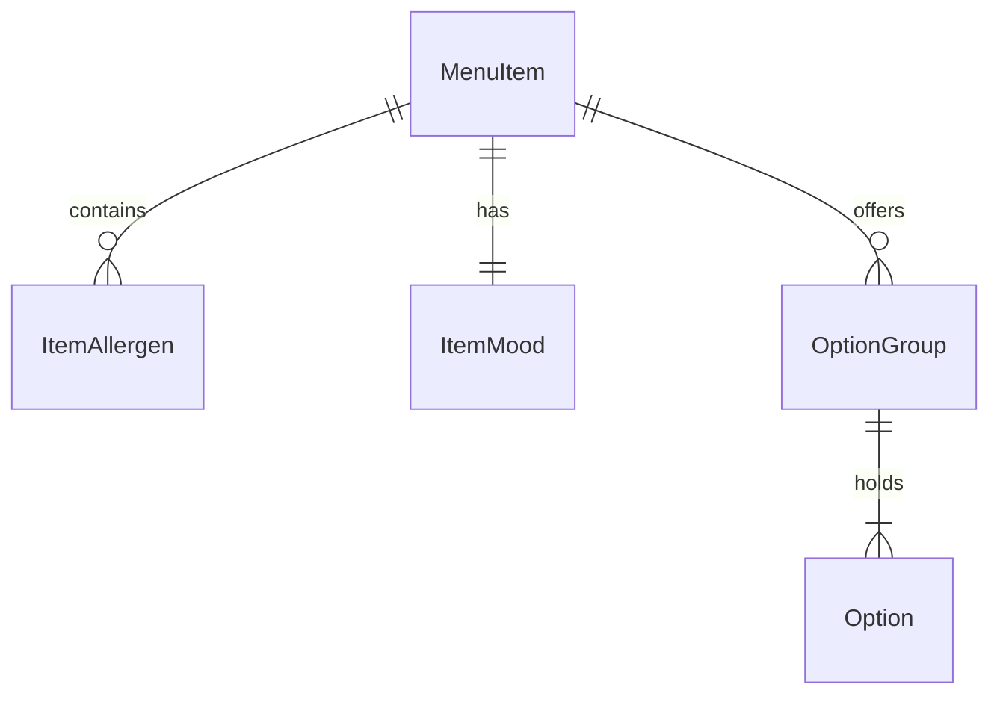

# Functional Spec: U5 Foundation

Implements these stories from `stories.md`: US2.1, US2.2, US7.1, US8.1, and the data parts of US3.2, US4.1 and US12.1. Shapes follow `contract-summary.md`, within `components.md` and `requirements.md`.

## Workflows

### W1 Server start

1. Read `PORT`, `DB_FILE`, and `STAFF_PIN`, or create and print a random 4-digit PIN.
2. Create the `schema_upgrades` record if it is missing.
3. Apply each unrecorded step, U5 then U6 then U7.
4. Seed v1's data if empty, then add missing menu details.
5. Register v1's routes, the staff check, and U6's and U7's routes.

### W2 Staff sign-in

1. A staff page asks whether a session exists, and shows nothing of its content meanwhile.
2. With no session, the PIN screen shows. The diner's tab bar isn't on it.
3. Staff enter 4 digits. A correct PIN sets the cookie and the page opens.
4. A wrong PIN shows "That PIN isn't right" and clears the entry.
5. When locked, the screen says to try again in 30 seconds.
6. Any later staff request answering 401 returns the page to step 2.

### W3 Diner session

1. A diner screen reads its own table through the new visit read, replacing the all-tables read.
2. It opens the live stream with its table id.
3. On reconnect, replay uses the same filter.

### W4 Slots and mounts

1. My orders shows switcher pills for its list, The Living Table, Kitchen Theatre and Spin the Bottle. The Menu shows a Chef's Dice button.
2. Each view loads its file only when opened. U5 ships a placeholder in each.
3. Slots receive `{ table, orders, onAddToCart }`, and Chef's Dice also receives `menu`.
4. Five mount points render nothing until U6 fills them: MenuExtras, CartExtras, OrderExtras, BoardExtras and BillExtras.

## State Machines

### PIN attempts for one address

| From | Event | To |
|---|---|---|
| Counting (0–4) | Correct PIN | Counting 0, signed in |
| Counting (0–3) | Wrong PIN | Counting +1 |
| Counting 4 | Wrong PIN | Locked |
| Locked | Any try within 30 seconds | Locked, refused |
| Locked | 30 seconds pass | Counting 0 |

## Items Added To The Contracts

These settle points left open at Contract Design:

- **BillExtras** is a fifth mount on the table bill, for U6's line options.
- **U6 may edit** v1's order and bill code directly, as those files aren't on the no-edit list.
- **Chef's Dice** gets `menu` as a prop.
- **`queue.changed`** is published by the order service when an order is placed, changes status or is cancelled. U5 adds this publishing, so U6 only reads it.
- **`GET /api/events`** with no `tableId` needs a session, or answers 401. With `tableId` it stays open.
- **Allergen ids and moods** are listed once, in `entities.md`.

## Open Mockup Points U5 Fixes

- Real 44 px touch areas on every button it builds.
- Status words stay Pending, Preparing and Completed.
- The PIN lockout state, and PIN dots that show the true entry count.
- Live changes announced to screen readers, and measured text contrast.

## Entity Relationships

Derived from `entities.md`.

Text version: a menu item has many allergens, one mood and many option groups, and each group holds options.

## Rules Summary

Derived from `rules.md`: BR1 staff access, BR2 diner access, BR3 upgrade and v1 protection, BR4 menu details, BR5 cart lines, BR6 design, BR7 errors.

## Business Scenarios

- A v1 database starts on v2: steps add, details are filled in by item name, v1 rows are unchanged, and a restart changes nothing.
- A diner opens table 3: it reads only table 3 and never receives table 4's events.
- A curious diner opens the board: PIN screen, and every staff request answers 401.
- Five wrong PINs, then the right one: refused until 30 seconds pass.

## Assumptions & Open Questions

- U5's slot placeholders show a short "Coming soon" line until U7 merges.
