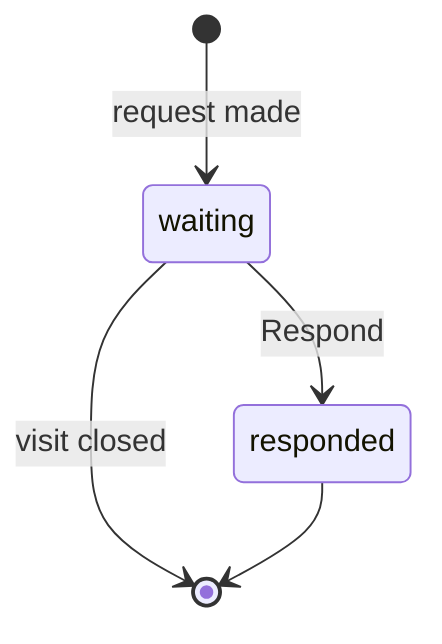
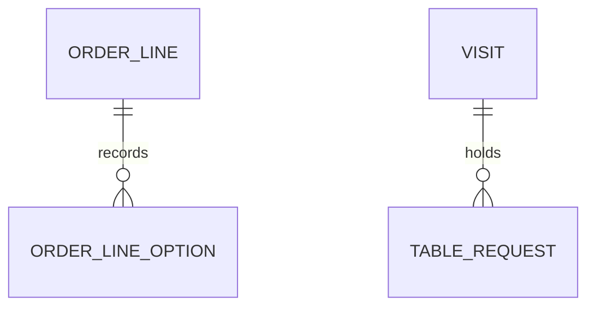

# Functional Specification: U6 Diner and Staff Features

Delivers US1.1 to US1.3, US3.1 to US3.3, US4.1 to US4.3, US5.1, US5.2, US6.1 and US6.2 from `stories.md`. Built on `unit-of-work.md`, `unit-of-work-story-map.md`, `requirements.md`, `components.md` and contracts C10 to C13 and C15 in `contract-summary.md`. Uses only v1 and U5.

## Workflows

### W1 Order ready banner

1. The diner screen reads its orders and listens to its table's live events.
2. For each order, on every read and every order event, it compares the status with the device's last-seen status, then saves the new status as last seen. An order first seen open on this screen therefore counts as seen.
3. A change to Completed from a last-seen Pending or Preparing raises a banner, unless dismissed (BR1.1, BR1.3).
4. On load or reconnect, several such orders share one banner (BR1.4).
5. Orders with no last-seen status, or from another visit, are recorded silently (BR1.5).
6. Unless muted, the device tries sound and vibration and ignores refusals (BR1.2, BR1.7).

### W2 Kitchen alert

1. The board receives `order.placed` on its all-tables stream.
2. It shows an alert naming the table and order number, with sound unless muted (BR1.6, BR1.7).

### W3 Allergy check

1. The diner opens Allergies from the Menu and picks from the eight allergens (BR3.1).
2. The Menu marks unsafe dishes in words (BR3.2).
3. The Cart names each unsafe dish and allergen (BR3.4).
4. Place order on an unsafe cart asks first. Confirm places the order, and Cancel changes nothing.

### W4 Customize and place

1. "+ Add" adds the defaults at once (BR4.1).
2. "Customize" opens the panel with the running price (BR4.2).
3. Adding from the panel creates or increases the line for that dish and those choices (BR4.6).
4. The order sends each line's option ids. Inside the placing transaction, the server validates them before the sold-out check (BR4.5), works out the unit price (BR4.4) and stores non-default or priced choices as snapshots.
5. A repeated placement key returns the existing order, as in v1.

### W5 Requests

1. A diner presses "Call the waiter" or "Ask for the bill" during an Open visit (BR5.1).
2. The server returns the waiting request, creating it only if none of that kind waits (BR5.2), and publishes `table-request.updated`.
3. Every board pulses the card and names the request (BR5.3). The diner's button shows that staff have been told.
4. Staff press Respond on one request (BR5.4). The pulse for it stops and the button resets within 2 seconds. An unknown id answers 404. Responding again, or after the visit closed, returns the request unchanged and publishes nothing.
5. Closing the table ends the requests (BR5.5). Boards drop them on `table.closed`, and request reads return only requests of Open visits, so a reload never shows a stale one.

### W6 Tracker and wait

1. An order read adds `estimateMinutes` to each Pending or Preparing order (BR6.2).
2. `order.updated` updates the bar, and `queue.changed` re-reads estimates (BR6.1).

## State Machine: TableRequest

<!-- Text fallback: a request starts waiting, becomes responded when staff respond, and ends when the visit closes. -->

Order statuses stay exactly as in v1.

## Entity Relationships (derived from entities.md)

<!-- Text fallback: an order line has zero or more recorded options, and a visit holds zero or more table requests. -->

## Rules Summary (derived from rules.md)

| Area | Key rules |
|---|---|
| Banners | Announce only orders this device saw open. Sound failures never stop a banner. |
| Allergies | Words not colour. Options never change marks. Confirm before an unsafe order. |
| Options | Server prices from ids. Invalid choices answer 400. No recorded options keeps v1's shape. |
| Requests | One waiting per kind. Respond needs staff. Closing clears. |
| Tracker | 10 plus 3 per earlier open order. |

## Data Additions

U6's `migrations()` adds the OrderLineOption and TableRequest tables only, with a uniqueness guard allowing one waiting request per visit and kind. The placed line's unit price includes its options, so v1's bill arithmetic is unchanged.

## v1 Server Code U6 Changes

No shared file in C10 is edited.

| File | Change |
|---|---|
| `server/ordering/repo.js` | Store option snapshots with each line. The single order mapping adds `options` to a line only when it has some, so every read, live event, ticket and bill carries them |
| `server/ordering/service.js` | Validate option ids, work out the line price and pass the snapshots to the repo |
| `server/tables/service.js` | Add `estimateMinutes` to Pending and Preparing orders in the diner's order read only |
| `server/features/u6.js` | The request routes and the tables above |

`server/billing/service.js` needs no change, because the bill reads orders through the same mapping. Live events do not carry `estimateMinutes`. Screens re-read on `queue.changed`, as contract C12 says.

## Error Handling

- A failed request shows a plain message and is logged on the server (NFR11).
- A failed request button returns to normal and lets the diner try again.
- Unreadable device storage counts as empty.

## Assumptions & Open Questions

- [assumption] A kitchen alert stays for 8 seconds and can be dismissed, and several alerts stack.
- [assumption] The diner's mute switch sits on My orders, as in the mockup, and applies on every diner screen.
- [assumption] The unsafe-cart confirmation is an in-page dialog, not a browser popup.
