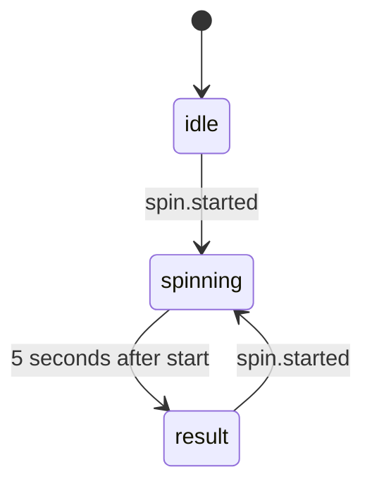
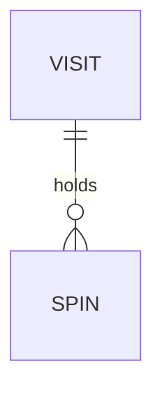

# Functional Specification: U7 3D X-factors

Delivers US9.1, US10.1, US11.1 and US12.1 from `stories.md`. Built on `unit-of-work.md`, `unit-of-work-story-map.md`, `requirements.md`, `components.md` and contracts C10, C12, C13, C14 and C16 in `contract-summary.md`. Uses only v1 and U5.

## Workflows

### W1 Open a scene

1. The diner opens a view from the My orders switcher or the Chef's Dice button.
2. The slot loads that scene's code only now (BR9.6).
3. If 3D can't start, the text version shows with no error (BR9.4).
4. Under reduced motion the scene is still (BR9.5).

### W2 The Living Table

1. Orders from My orders become plates (BR9.1) with a state each (BR9.2).
2. An order change updates plates within 2 seconds.
3. Drag or arrow keys spin the table (BR9.3).

### W3 Kitchen Theatre

1. Each non-Cancelled order becomes a ticket at its station (BR10.1), showing number and status in words (BR10.2).
2. An order change moves its ticket within 2 seconds.

### W4 Spin the Bottle

1. While the visit is Open, the diner chooses 2 to 8 seats and a question and presses Spin.
2. The server validates (BR11.1, BR11.2). Inside one transaction it checks the 5-second window (BR11.4), picks the seat (BR11.3) and stores the spin.
3. `spin.started` is published after the spin is committed, and reaches every open diner screen of that table within 2 seconds.
4. Time is never measured on the device's clock against `startedAt`. A screen animates for 5 seconds less `elapsedMs`, counted from when it received the event or read, and held between 0 and 5 seconds. The live event's `elapsedMs` is 0, and a read carries the server's own elapsed time. Under reduced motion or with no 3D the result shows at once.
5. A screen opened during a spin reads the current one (BR11.5). An unknown table answers 404, like other table routes. If the table closes during a spin, the screen's closed view replaces it.
6. A refused spin shows a plain message and leaves the current spin running.

### W5 Chef's Dice

1. The diner picks Light, Hearty, Sweet or Surprise me.
2. Tap, Enter or a shake rolls the dice (BR12.2).
3. One qualifying dish shows, with "Add to cart" and "Roll again" (BR12.1), or a message that none qualifies (BR12.3).
4. "Add to cart" adds the dish with its default choices.

## State Machine: Spin View

<!-- Text fallback: the view is idle until a spin starts, spins until 5 seconds after the start, then shows the result until another spin starts. -->

## Entity Relationships (derived from entities.md)

<!-- Text fallback: a visit holds zero or more spins. -->

## Rules Summary (derived from rules.md)

| Area | Key rules |
|---|---|
| Scenes | Loaded on demand. Text version where 3D can't run. Still under reduced motion. |
| Spin | Open visits only. 2 to 8 seats. Server picks. One spin per 5 seconds. No names or payment. |
| Dice | Matches mood, not sold out, none of the chosen allergens. |

## Code U7 Changes

| File | Change |
|---|---|
| `server/features/u7.js` | The spin routes and the Spin table |
| `client/src/xfactors/*.jsx` | The four scenes, replacing U5's placeholders |
| `package.json` | Adds three.js |

No shared file in C10 and no v1 server code changes.

## Error Handling

- A failed spin or read shows a plain message and is logged on the server (NFR11).
- A scene that fails while running falls back to its text version.

## Assumptions & Open Questions

- [assumption] Chef's Dice receives `orders` as an empty list, as U5's notes say, and needs no orders.
- [assumption] Chef's Dice reads dishes from the `menu` prop `MenuScreen.jsx` already passes it, which adds to the props listed in C14.
- [assumption] The 3D table draws at most 12 plates, while its text summary and fallback list every unit.
