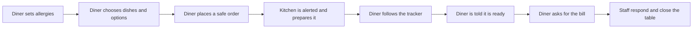

# Scope Document: Table Order v2

This scope builds on the problem, customer and success measures in `intent-statement.md`: independent sit-down restaurants choosing an ordering app that serves diners better and keeps staff on top of busy service.

## In Scope

| Capability | Group | Outcome |
|---|---|---|
| Notifications | Left out of v1 | The diner learns when an order is ready, and staff learn of new orders |
| Staff PIN | Left out of v1 | Staff pages ask for a PIN |
| Allergy shield | Most apps don't have | The diner sets allergies once, unsafe dishes are marked, and the cart warns before an unsafe order |
| Make it yours | Most apps don't have | Item options change the price and reach the kitchen ticket |
| Call the waiter / Ask for the bill | X-factor | A diner's request stands out to staff until they respond |
| Animated order tracker | X-factor | The diner sees how far along the order is, with the estimated wait |
| The Living Table | X-factor | A 3D table where each dish ordered is a plate that follows the kitchen's progress |
| Kitchen Theatre | X-factor | A 3D miniature kitchen where the diner's tickets travel along a rail |
| Spin the Bottle | X-factor | A shared 3D bottle spin that picks who pays or orders dessert |
| Chef's Dice | X-factor | 3D dice that suggest a dish for the diner's mood and allergies |
| Design system | Required by the brief | New screens and the diner screens share one creative look with 3D depth |

## Out of Scope

- Payments, native mobile apps, cloud deployment, diner accounts, email or SMS, and anything that needs a paid external service.
- Any new look for the kitchen board and table bill.
- Every feature in the brief's lists that was not chosen.

## Changes to v1

Anything not listed here stays as signed off.

| Screen or behaviour | What changes | Why |
|---|---|---|
| Menu | Adds allergy marks, item options and the Call the waiter / Ask for the bill buttons | Allergy shield, Make it yours, and the X-factor need a place on the diner's main screen |
| Cart | Adds a warning before an unsafe order, and shows chosen options and their prices | Allergy shield and Make it yours |
| My orders | Adds the order tracker, the "order ready" notice, and chosen options | Animated order tracker, Notifications and Make it yours |
| Kitchen board | Adds chosen options on tickets, new-order alerts, and pulsing table cards with a way to respond | Make it yours, Notifications, and the X-factor |
| Table bill | Shows chosen options and prices on bill lines | Make it yours changes what a line costs |
| Opening any staff page | Now asks for a PIN first | Staff PIN protects every staff page |

| Menu, Cart and My orders | A bold new look with 3D depth from the design system, plus Chef's Dice on the Menu and The Living Table, Kitchen Theatre and Spin the Bottle on My orders | Chosen by the team during Requirements Analysis on 2026-11-09, to stand out to the judges |

The kitchen board and table bill keep v1's look. New screens and the three restyled diner screens use the new design system.

v1 tests that open staff pages will need to enter the PIN, and that change will be recorded where the work is built.

## Value Stream

Text version: the diner sets allergies, chooses dishes and options, and places a safe order. The kitchen is alerted and prepares it, while the diner follows the tracker and is told when it is ready. The diner asks for the bill, and staff respond and close the table.

## Hard Deadline

The work is handed in by the end of Tuesday 10 November 2026, with a 5-minute demo afterwards.

## Assumptions & Open Questions

- Notifications are in-app only, because email, SMS and paid services are out of scope. Requirements Analysis settles sound or vibration.
- The tracker's estimated wait is still open: where it comes from and whether it shows minutes or "about right / running late". Requirements Analysis settles this, as the brief's open question says.
- Success means the work is ready for the workshop demo. It does not measure actual restaurant adoption.
