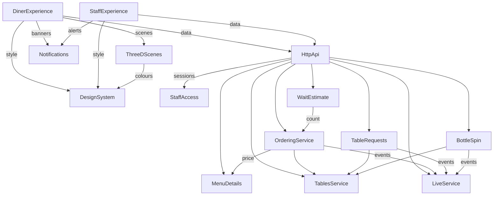

# Components: Table Order v2

Built from `requirements.md` and `stories.md`, on top of the v1 parts described in `architecture.md` and `component-inventory.md`. v1 parts appear only where v2 extends them.

```yaml
components:
  - name: LiveService
    summary: v1's stored and broadcast live events, now able to limit a stream to one table for diners.
    behaviour: >
      Keeps v1's replay and resync. A stream with no table id is the all-tables stream and needs a staff session,
      which the HttpApi checks. A stream with a table id receives only that table's events and events with no table.
    responsibilities:
      - Store and deliver live events
    depends_on: []
    dependents:
      - component: OrderingService
        interaction: Publish order events
      - component: TableRequests
        interaction: Publish request events
      - component: BottleSpin
        interaction: Publish spin events
      - component: HttpApi
        interaction: Open streams
    external_dependencies:
      - name: SQLite
        kind: database
        purpose: Stored events
    entities: []
  - name: TablesService
    summary: v1's tables and visits, plus a read of one table's own current visit for diners.
    behaviour: >
      Adds a read that returns only one table's current visit, so the all-tables board read can be staff-only.
    responsibilities:
      - Tables and visits
    depends_on: []
    dependents:
      - component: OrderingService
        interaction: Check the open visit
      - component: TableRequests
        interaction: Find the open visit
      - component: BottleSpin
        interaction: Find the open visit
      - component: HttpApi
        interaction: Read tables
    external_dependencies:
      - name: SQLite
        kind: database
        purpose: Tables and visits
    entities: []
  - name: MenuDetails
    summary: Allergens, option groups and moods for each menu item.
    behaviour: >
      Each item records which of the eight allergens it contains and one mood. Option groups are pick-one with a default,
      or pick-any. An option is offered only on an item already marked with every allergen that option contains.
      Choosing an option never changes an item's allergens. At least one item exists for each case: a pick-one group,
      extras, each allergen and each mood.
    responsibilities:
      - Allergen, option and mood data, added to an existing database without changing v1's rows
    depends_on: []
    dependents:
      - component: OrderingService
        interaction: Price and validate chosen options
      - component: HttpApi
        interaction: Include details in the menu read
    external_dependencies:
      - name: SQLite
        kind: database
        purpose: Menu details
    entities:
      - name: OptionGroup
        identifier: id
        attributes: [itemId, name, kind, position]
      - name: Option
        identifier: id
        attributes: [groupId, name, priceDeltaCents, isDefault, position]
      - name: ItemAllergen
        identifier: itemId and allergen
        attributes: [itemId, allergen]
      - name: ItemMood
        identifier: itemId
        attributes: [itemId, mood]
  - name: OrderingService
    summary: v1's order placing and moves, extended with chosen options and their prices.
    behaviour: >
      Works out each line's price from option ids on the server. Refuses a choice that doesn't belong to the item, or two
      choices in a pick-one group. A pick-one group left out takes its default. An order with no options keeps exactly v1's shape.
    responsibilities:
      - Orders, lines and chosen options
    depends_on:
      - component: MenuDetails
        interaction: Price and validate options
        style: sync
      - component: TablesService
        interaction: Check the open visit
        style: sync
      - component: LiveService
        interaction: Publish order events
        style: event
    dependents:
      - component: WaitEstimate
        interaction: Count earlier open orders
      - component: HttpApi
        interaction: Place and move orders
    external_dependencies:
      - name: SQLite
        kind: database
        purpose: Orders and chosen options
    entities:
      - name: OrderLineOption
        identifier: id
        attributes: [orderLineId, name, priceDeltaCents, position]
        references:
          - entity: Option
            owned_by: MenuDetails
            relationship: Each chosen option is a snapshot taken from one menu option
  - name: WaitEstimate
    summary: Works out the estimated wait for an open order.
    behaviour: >
      The estimate is 10 minutes plus 3 for every Pending or Preparing order placed earlier, across all tables.
      It is the same rule for Pending and Preparing orders. Completed and Cancelled orders have none.
    responsibilities:
      - The wait rule
    depends_on:
      - component: OrderingService
        interaction: Count earlier open orders
        style: sync
    dependents:
      - component: HttpApi
        interaction: Include the estimate in order reads
    entities: []
  - name: TableRequests
    summary: Call the waiter and Ask for the bill requests.
    behaviour: >
      A visit holds at most one waiting request of each kind. Repeats change nothing. Respond clears one request.
      Requests belong to a visit, so closing the visit ends them.
    responsibilities:
      - Stored waiting requests and their events
    depends_on:
      - component: TablesService
        interaction: Find the open visit
        style: sync
      - component: LiveService
        interaction: Publish request events
        style: event
    dependents:
      - component: HttpApi
        interaction: Create, read and respond
    external_dependencies:
      - name: SQLite
        kind: database
        purpose: Waiting requests
    entities:
      - name: TableRequest
        identifier: id
        attributes: [visitId, kind, status, createdAt, respondedAt]
  - name: BottleSpin
    summary: The shared Spin the Bottle result for a table.
    behaviour: >
      The server chooses the seat. Only an Open visit can spin, with 2 to 8 seats. The first spin is accepted and others are
      refused until 5 seconds after it started. A screen opened during a spin reads the current result.
    responsibilities:
      - Spin rules, the current spin and its events
    depends_on:
      - component: TablesService
        interaction: Find the open visit
        style: sync
      - component: LiveService
        interaction: Publish spin events
        style: event
    dependents:
      - component: HttpApi
        interaction: Spin and read the current spin
    external_dependencies:
      - name: SQLite
        kind: database
        purpose: Current spin
    entities:
      - name: Spin
        identifier: id
        attributes: [visitId, question, seats, resultSeat, startedAt]
  - name: StaffAccess
    summary: The staff PIN, sessions and wrong-try lockout.
    behaviour: >
      Reads the PIN from STAFF_PIN, or makes a random 4-digit PIN and prints it. A correct PIN creates a session held in a
      cookie that page scripts can't read and that ends when the browser closes. Five wrong tries in a row from one network
      address block that address for 30 seconds, on the server. Tests reset the counter between specs.
    responsibilities:
      - Checking the PIN and sessions
    depends_on: []
    dependents:
      - component: HttpApi
        interaction: Check staff-only requests
    entities:
      - name: StaffSession
        identifier: token
        attributes: [token, createdAt]
  - name: HttpApi
    summary: v1's routes, plus staff checks and the new routes.
    behaviour: >
      Answers 401 to every staff-only request without a session: the all-tables board read and stream, moves, sold-out marks,
      bills, close and Respond. Every diner route stays open.
    responsibilities:
      - Routes, the staff check and error replies
    depends_on:
      - component: StaffAccess
        interaction: Check sessions
        style: sync
      - component: MenuDetails
        interaction: Read menu details
        style: sync
      - component: OrderingService
        interaction: Orders
        style: sync
      - component: WaitEstimate
        interaction: Estimates
        style: sync
      - component: TablesService
        interaction: Tables
        style: sync
      - component: LiveService
        interaction: Streams
        style: sync
      - component: TableRequests
        interaction: Requests
        style: sync
      - component: BottleSpin
        interaction: Spins
        style: sync
    dependents:
      - component: DinerExperience
        interaction: All diner data
      - component: StaffExperience
        interaction: All staff data
    entities: []
  - name: DesignSystem
    summary: The Midnight Supper Club tokens and components.
    behaviour: >
      The single source of colours, type, spacing, radius, shadows and components, applied only to diner and new screens.
      Keeps the 3-tab bar, sticky pills, 44 px touch areas, keyboard access and reduced motion.
    responsibilities:
      - Shared look
    depends_on: []
    dependents:
      - component: DinerExperience
        interaction: Styling
      - component: StaffExperience
        interaction: Styling of the PIN screen
      - component: ThreeDScenes
        interaction: Scene colours
    entities: []
  - name: Notifications
    summary: Banners, sound, vibration and mute on a device.
    behaviour: >
      Announces only orders this device last saw as open, in the current visit, and groups several into one banner.
      Orders never seen and orders of closed visits raise nothing. Remembers mute and dismissed banners on the device.
    responsibilities:
      - Banner display and device preferences
    depends_on: []
    dependents:
      - component: DinerExperience
        interaction: Order ready banners
      - component: StaffExperience
        interaction: New order alerts
    entities: []
  - name: ThreeDScenes
    summary: The Living Table, Kitchen Theatre, the bottle and the dice.
    behaviour: >
      Each scene loads only when opened. Where 3D can't run, each shows the same information as text. Under reduced motion
      scenes are still, and spins and rolls show their result at once. Plates show one per unit of quantity, up to 12.
    responsibilities:
      - Drawing and animating 3D scenes
    depends_on:
      - component: DesignSystem
        interaction: Scene colours
        style: sync
    dependents:
      - component: DinerExperience
        interaction: Show scenes
    external_dependencies:
      - name: three.js
        kind: other
        purpose: Drawing real 3D in the browser
    entities: []
  - name: DinerExperience
    summary: Menu, Cart and My orders, with allergy, options, tracker and X-factor views.
    behaviour: >
      Keeps allergies on the device. The Contains mark and cart warning depend only on the dish and never on options.
      Cart lines are identified by dish and choices. v1 saved carts still load, with default choices.
    responsibilities:
      - Diner screens and on-device diner settings
    depends_on:
      - component: HttpApi
        interaction: Data and actions
        style: sync
      - component: DesignSystem
        interaction: Styling
        style: sync
      - component: Notifications
        interaction: Banners
        style: sync
      - component: ThreeDScenes
        interaction: Scenes
        style: sync
    dependents: []
    entities: []
  - name: StaffExperience
    summary: The PIN screen, plus additions to the kitchen board and table bill.
    behaviour: >
      Shows the PIN screen until a session exists. Adds alerts, options, pulsing cards and one Respond button per request.
      Otherwise keeps v1's look.
    responsibilities:
      - Staff screens
    depends_on:
      - component: HttpApi
        interaction: Data and actions
        style: sync
      - component: DesignSystem
        interaction: Styling of the PIN screen
        style: sync
      - component: Notifications
        interaction: New order alerts
        style: sync
    dependents: []
    entities: []
```

## Component Diagram



Text version: the diner and staff screens call the HTTP API, which checks staff access and calls the services. Services publish through the live service. Diner screens use the design system, notifications and 3D scenes.

## Component Summary

| Component | Purpose | Depends On | Dependents | Entities Owned |
|---|---|---|---|---|
| LiveService | Live events | None | OrderingService, TableRequests, BottleSpin, HttpApi | None |
| TablesService | Tables and visits | None | OrderingService, TableRequests, BottleSpin, HttpApi | None |
| MenuDetails | Allergens, options, moods | None | OrderingService, HttpApi | OptionGroup, Option, ItemAllergen, ItemMood |
| OrderingService | Orders with options | MenuDetails, TablesService, LiveService | WaitEstimate, HttpApi | OrderLineOption |
| WaitEstimate | The wait rule | OrderingService | HttpApi | None |
| TableRequests | Waiter and bill requests | TablesService, LiveService | HttpApi | TableRequest |
| BottleSpin | Shared spin | TablesService, LiveService | HttpApi | Spin |
| StaffAccess | PIN and sessions | None | HttpApi | StaffSession |
| HttpApi | Routes and staff checks | All server services | DinerExperience, StaffExperience | None |
| DesignSystem | Shared look | None | DinerExperience, StaffExperience, ThreeDScenes | None |
| Notifications | Banners and mute | None | DinerExperience, StaffExperience | None |
| ThreeDScenes | 3D scenes | DesignSystem | DinerExperience | None |
| DinerExperience | Diner screens | HttpApi, DesignSystem, Notifications, ThreeDScenes | None | None |
| StaffExperience | Staff screens | HttpApi, DesignSystem, Notifications | None | None |

## Entity Ownership

| Entity | Owning Component | Identifier | Attributes | References |
|---|---|---|---|---|
| OptionGroup | MenuDetails | id | itemId, name, kind, position | None |
| Option | MenuDetails | id | groupId, name, priceDeltaCents, isDefault, position | None |
| ItemAllergen | MenuDetails | itemId and allergen | itemId, allergen | None |
| ItemMood | MenuDetails | itemId | itemId, mood | None |
| OrderLineOption | OrderingService | id | orderLineId, name, priceDeltaCents, position | Option in MenuDetails |
| TableRequest | TableRequests | id | visitId, kind, status, createdAt, respondedAt | None |
| Spin | BottleSpin | id | visitId, question, seats, resultSeat, startedAt | None |
| StaffSession | StaffAccess | token | token, createdAt | None |

## External Dependencies

| Component | Dependency | Kind | Purpose |
|---|---|---|---|
| Server services | SQLite | database | Stored data |
| ThreeDScenes | three.js | other | Real 3D in the browser |

## Rationale

| Component | Why it is separate |
|---|---|
| MenuDetails | Menu data with its own safety rules, and it changes separately from orders |
| WaitEstimate | A rule likely to change, and easy to test alone |
| TableRequests | Its own lifecycle, separate from orders |
| BottleSpin | A table game with no link to ordering |
| StaffAccess | A security concern used by every staff route |
| Notifications | Used by both diner and staff screens |
| ThreeDScenes | Heavy code loaded only on demand, with its own fallback rules |
| DesignSystem | One written source of the look |

Only one decomposition is viable, because v1's modular structure already sets the boundaries and each new concern has its own data or lifecycle.
