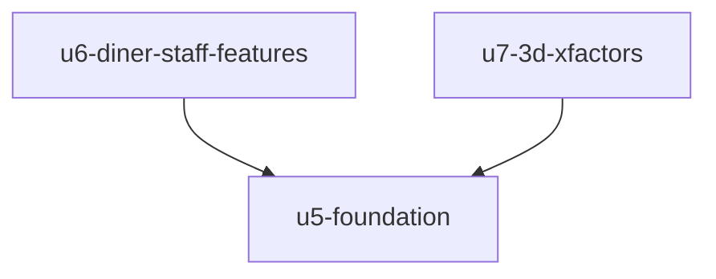

# Unit Dependencies: Table Order v2

Based on `components.md`, `decisions.md`, `requirements.md` and `stories.md`.

## Dependency Graph



Text version: U6 and U7 each depend on U5, and on nothing else.

```yaml
units:
  - name: u5-foundation
    kind: service
    depends_on: []
  - name: u6-diner-staff-features
    kind: service
    depends_on: [u5-foundation]
  - name: u7-3d-xfactors
    kind: service
    depends_on: [u5-foundation]
```

## Integration Points

| From | To | Through |
|---|---|---|
| U6 | U5 | Menu details in the menu read, the staff check, live event types, design system, mount places on screens |
| U7 | U5 | The switcher slots, the Chef's Dice button, the staff-free diner stream, menu details and moods, design system |

## Parallel Development

U6 and U7 have no edge between them, so each can be built with only its own code and U5. Their files don't overlap, because U5 creates the shared mount places first.

## Skeleton

U5 is the first Unit and the integrated slice. It runs on its own: the app opens in the new look, staff pages ask for the PIN, and orders flow through the existing screens.

## Assumptions & Open Questions

None.
